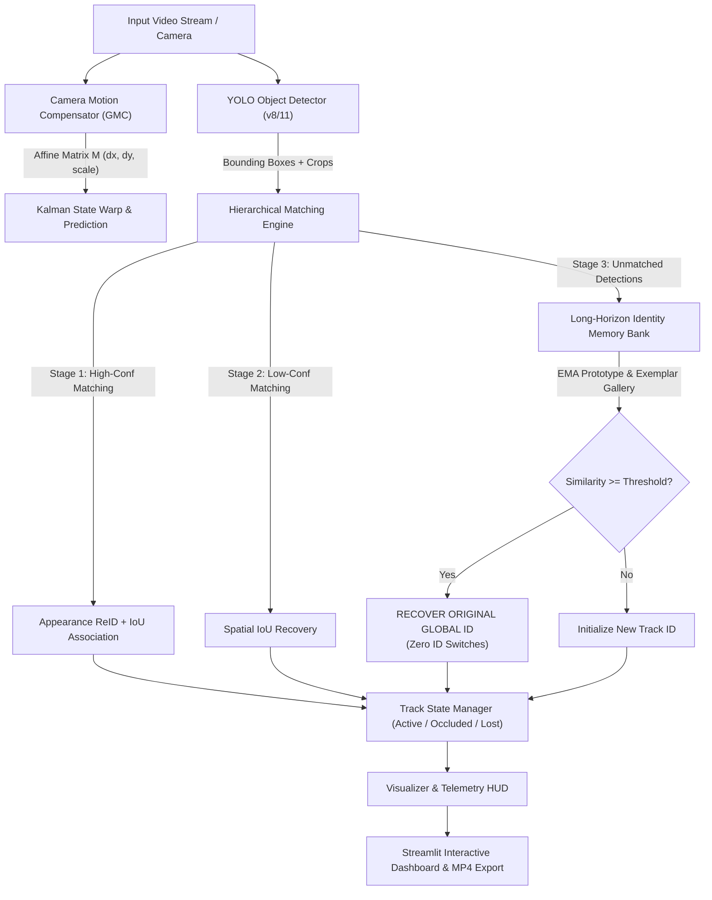

# TRACK THE UNTRACKABLE 🎯
### Long-Horizon Multi-Object Identity Recovery Under Camera, Occlusion & Appearance Drift

[](https://www.python.org/)
[](https://pytorch.org/)
[](https://docs.ultralytics.com/)
[](https://streamlit.io/)
[](https://opensource.org/licenses/MIT)

---

## 📌 Executive Summary

Modern multi-object tracking (MOT) systems—including standard ByteTrack, DeepSORT, and BoT-SORT—suffer catastrophic identity degradation in dynamic real-world surveillance and robotics scenarios. When targets are occluded behind obstacles (such as walls, billboards, vehicles, or crowd clusters) for extended periods (50–300+ frames), traditional trackers discard tracklets after a brief timeout (typically 30 frames), assigning a **brand-new identity upon re-emergence** (an **ID switch**). Compounding this failure, camera pan, tilt, and zoom (ego-motion) drift corrupts spatial Kalman filter state predictions.

**TRACK THE UNTRACKABLE** resolves this foundational challenge through a unified, long-horizon multi-object identity recovery pipeline:

1. **Global Motion Compensation (GMC)**: Decouples camera ego-motion using background sparse optical flow (Lucas-Kanade) and RANSAC affine modeling, warping Kalman filter state vectors to ensure accurate spatial trajectory extrapolation even during violent camera panning.
2. **Deep Appearance Re-Identification (ReID)**: Extracts 512-dimensional L2-normalized embeddings via Part-Based Spatial Pooling (upper torso vs. lower body) fused with color histogram signatures, providing invariance to pose flips and appearance drift.
3. **Long-Horizon Identity Memory Bank**: Retains occluded and lost target signatures across hundreds of frames (~20+ seconds). Implements Exponential Moving Average (EMA) prototype feature vectors and diverse exemplar galleries.
4. **Hierarchical Confidence-Aware Recovery Engine**: Two-stage association (high-confidence detection matching + low-confidence partial occlusion matching), combined with a third-stage global identity memory query combining cosine similarity, spatial likelihood, and temporal decay gating.

---

## 🏗️ System Architecture



---

## 🚀 Quickstart Guide (Windows & Linux)

### Prerequisites
- Python 3.10, 3.11, 3.12, or 3.13
- Git

### 1. Installation
Clone the repository and install dependencies:

```bash
git clone https://github.com/yashu719/TRACK-THE-UNTRACKABLE.git
cd TRACK-THE-UNTRACKABLE
python -m pip install -r requirements.txt
```

> **Note**: For GPU acceleration (optional), ensure PyTorch with CUDA is installed. The system automatically detects and optimizes for CPU or CUDA.

---

### 2. Launch the Application

Run the Streamlit dashboard:

```bash
python -m streamlit run app.py
```

The application will launch in your default web browser at `http://localhost:8501`.

---

### 3. Running Unit Tests

Run the comprehensive unit test suite:

```bash
python -m unittest discover -s tests -v
```

All 11 unit tests covering detection, camera motion compensation, ReID feature extraction, memory bank updates, and end-to-end occlusion recovery will run and validate the pipeline.

---

## 💻 Dashboard Features

- **Video Upload & Processing**:
  - Upload `.mp4`, `.avi`, `.mov`, or `.mkv` files.
  - By default, process each upload in both directions and reconcile track IDs across passes before exporting the video in its original playback order. This improves identity continuity when a target is only visible from one direction; disable **Track forward and backward** in the sidebar for a faster forward-only pass.
  - Or click **"Generate Synthetic Occlusion & Camera Drift Benchmark"** to test the system with a pre-configured challenge sequence (moving camera pan, distinctive clothing appearances, and a 35-frame complete pillar occlusion).
- **Interactive Telemetry HUD**:
  - Live bounding boxes with persistent IDs and status badges:
    - `ID # [ACTIVE]` (Solid vibrant color)
    - `ID # [OCCLUDED: Predicting]` (Dashed amber box)
    - `ID # [RECOVERED (sim: 0.89)]` (Glowing magenta highlight)
  - Motion trajectory trails showing historical paths.
  - Top-right Camera Ego-Motion Compass (GMC vector).
- **Analytics & Reporting**:
  - **Metric Cards**: Active Tracks, Recovered Identities, Prevented ID Switches, Max Occlusion frames survived.
  - **Identity Longevity Timeline**: Interactive Plotly scatter plot showing tracking continuity and re-emergence points.
  - **Identity Memory Gallery**: Visual profile cards for all tracked targets with lifespan frame ranges.
  - **Exports**: One-click download of processed tracking video (`.mp4`) and detailed tracking telemetry (`.csv`).

---

## 📂 Project Structure

```
TRACK-THE-UNTRACKABLE/
├── app.py                   # Streamlit dashboard and user interface
├── detection.py             # YOLOv8 object detector with crop extraction
├── tracking.py              # Hierarchical tracker with Kalman filter & ReID fusion
├── reid.py                  # Part-based deep ReID extractor + HSV color histograms
├── identity_memory.py       # Long-horizon identity memory bank & recovery engine
├── camera_motion.py         # Global Motion Compensation (GMC) via Lucas-Kanade optical flow
├── benchmark_generator.py   # Synthetic video benchmark generator (occlusion + camera pan)
├── visualizer.py            # Overlay visualizer (boxes, badges, trajectory trails, HUD)
├── config.py                # Centralized dataclass configurations and hyper-parameters
├── requirements.txt         # Project dependencies
├── README.md                # Documentation and execution instructions
├── .gitignore               # Ignored cache, models, and temporary files
└── tests/                   # Automated unit test suite
    ├── __init__.py
    ├── test_camera_motion.py
    ├── test_reid.py
    ├── test_identity_memory.py
    ├── test_detection.py
    └── test_tracker_integration.py
```

---

## 🔬 Mathematical Formulations

### 1. Global Motion Compensation (GMC)
Between consecutive frames $I_{t-1}$ and $I_t$, background keypoints $\mathbf{p}_{t-1}$ are tracked to $\mathbf{p}_t$ via Lucas-Kanade optical flow. The rigid affine transformation $M \in \mathbb{R}^{2 \times 3}$ is estimated via RANSAC:
$$\mathbf{p}_t = M \begin{bmatrix} \mathbf{p}_{t-1} \\ 1 \end{bmatrix}$$
Kalman filter state mean $\hat{\mathbf{x}}$ and covariance $P$ are warped prior to prediction:
$$\hat{\mathbf{x}}' = \mathcal{W}_M(\hat{\mathbf{x}}), \quad P' = J_M P J_M^T$$

### 2. Multi-Part Appearance Embedding
For an image crop $C$, the appearance feature combines deep convolutional embeddings $\mathbf{f}_{deep}$ with part-based upper/lower HSV color histograms $\mathbf{f}_{col}$:
$$\mathbf{f} = \text{L2\_Norm}\Big((1 - w_{col})\mathbf{f}_{deep} + w_{col}\mathbf{f}_{col}\Big)$$

### 3. Long-Horizon Memory Recovery Score
When querying lost target $i$ with newly emerged detection $j$:
$$\text{Score}(i, j) = (1 - w_s) \cdot \cos(\mathbf{f}_j, \mathbf{f}_i^{gallery}) + w_s \cdot \exp\left(-\frac{\|\mathbf{p}_j - \mathbf{p}_i^{pred}\|_2}{3 \cdot \text{diag}(\text{bbox})}\right) \cdot \exp\left(-\frac{\Delta t}{\tau}\right)$$
If $\text{Score}(i, j) \ge \theta_{recovery}$, the track is revived under its original global ID, **preventing an identity switch**.

---

## 📜 License
This project is open-source and licensed under the [MIT License](LICENSE).
